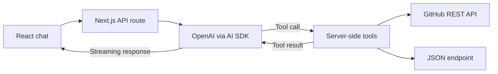

# Streaming AI Chat with Tools

A Next.js chat interface that streams responses from an OpenAI model and lets the model call two server-side tools: look up a public GitHub profile and fetch JSON from a URL. GitHub profile results are rendered as a compact profile card in the conversation.

## Features

- Stream assistant responses into a chat UI, with Markdown rendering and error display.
- Call a GitHub profile tool backed by Octokit and validate tool inputs with Zod.
- Call a generic HTTP GET tool that returns a JSON response.
- Render the GitHub profile tool result in the message stream.
- Limit a model turn to five tool or response steps.

## Stack

- Next.js 15 and React 19 with TypeScript.
- Vercel AI SDK 5 (`ai`, `@ai-sdk/react`, and `@ai-sdk/openai`).
- OpenAI as the currently selected model provider; an OpenRouter provider is also configured in the code as an alternative.
- Octokit for GitHub REST API access, Zod for tool input schemas, and Biome for lint and formatting commands.

## Run locally

You need Node.js and pnpm. Create `.env.local` from `.env.example`, replace the sample values, and start the app:

```bash
pnpm install
pnpm dev
```

Open `http://localhost:3000`.

The active chat route currently calls `openai('gpt-5')`, so set a valid `OPENAI_API_KEY`. `OPENROUTER_API_KEY` is present for the configured alternative provider, but OpenRouter is not selected in the active route. `GITHUB_TOKEN` is read by Octokit and can be set for authenticated GitHub API access; public profile lookups may also work without it, subject to GitHub's unauthenticated limits.

Other configured package scripts:

```bash
pnpm lint
pnpm build
pnpm start
```

There is no test script configured in `package.json`.

## Tools and data flow

The client posts chat messages to `/api/ai`. The route converts UI messages to model messages and streams the model response back. Available tools are declared in `src/ai/tools/`:

- `githubProfile` retrieves selected public profile fields for a GitHub username.
- `fetchHTTP` sends a GET request to a supplied URL and returns its JSON body.



## Current scope and limitations

- The app does not persist chat history. The sidebar's recent-chat list and new-chat control are UI scaffolding rather than saved-session features.
- The UI renders GitHub profile tool output, but does not currently display successful `fetchHTTP` results as a dedicated result view.
- `fetchHTTP` accepts a model-provided URL without host allowlisting or network restrictions. Do not expose this endpoint publicly without adding URL validation and server-side access controls.
- The OpenAI model name is fixed in the API route. Provider selection and model settings are not user-configurable.
- No automated test suite is configured.

## Project context

A practical prototype developed during my postgraduate studies, focused on streaming responses, model-invoked tools, and rendering structured tool output in a chat interface. It uses the Vercel AI SDK rather than implementing a separate SDK.

## Source guide

| Source | What to inspect |
| --- | --- |
| [Chat endpoint](src/app/api/ai/route.ts) | Model selection, streaming, tools, and the five-step stopping condition. |
| [GitHub profile tool](src/ai/tools/github-profile.ts) | Input schema and Octokit profile lookup. |
| [HTTP tool](src/ai/tools/http-fetch.ts) | URL input schema and server-side JSON retrieval. |
| [Conversation UI](src/components/chat.tsx) | Message rendering and handling of tool output. |
| [Profile card](src/components/github-profile.tsx) | Presentation of selected GitHub profile fields. |

## Example review flow

With your own provider credentials configured, a prompt such as “Show the public GitHub profile for octocat” exercises the profile tool and its result card. The model decides whether to invoke a tool; tool definitions and server execution determine what that invocation can do.

Zod validates the structure of tool inputs. It does not verify the truth of model-generated statements or validate all external response content. This prototype uses AI SDK tool calling directly; it does not expose an MCP server or implement retrieval-augmented generation.
